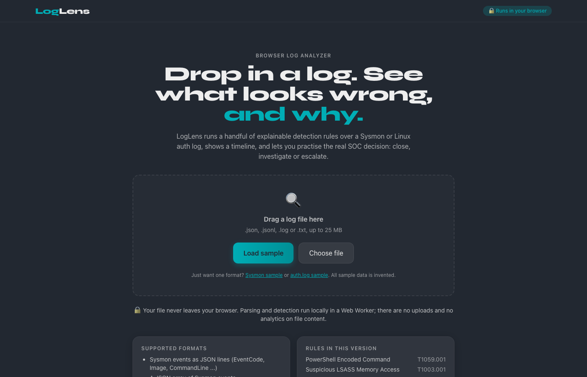
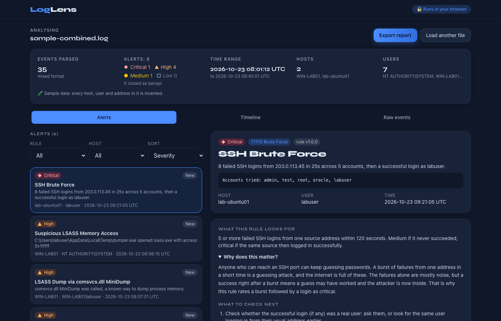
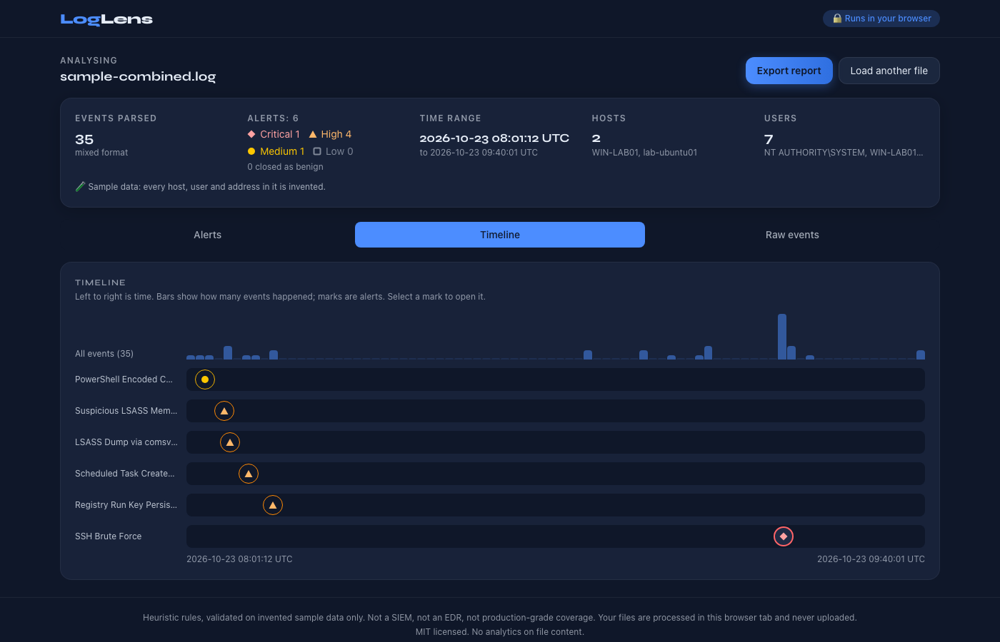
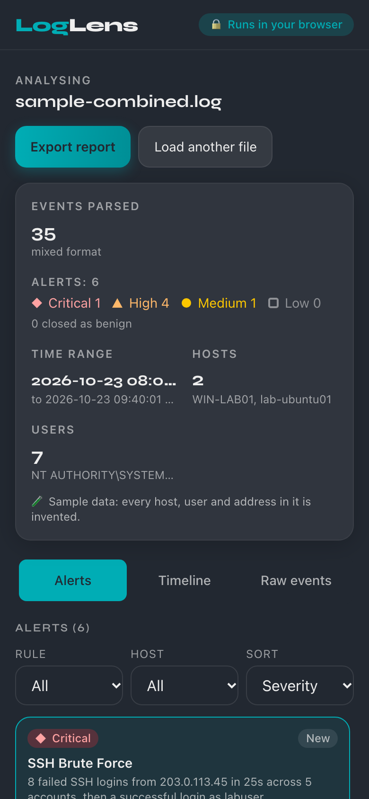

# LogLens

A browser log analyzer. Drop in a Sysmon or Linux auth log and LogLens flags the events that look suspicious, explains why in plain language, and lets you practise the real SOC decision: close, investigate or escalate, with a note.

**Everything runs in your browser. Your file is never uploaded.**

> **Heuristics, not verdicts.** The rules are simple heuristics validated on *invented* sample data only. They will miss real attacks and flag harmless activity. LogLens is a learning and portfolio project, not a SIEM, an EDR or production-grade coverage.









Built on the rules from my [SOC Detection Lab](../soc-detection-lab) (Python + Sigma + SPL), ported to TypeScript.

## Features

- Load the bundled invented samples in one click, or drop in your own `.json`, `.jsonl`, `.log` or `.txt` (max 25 MB).
- Format auto-detection (see Supported formats below). If a file yields no recognised events, LogLens lists the supported formats and shows the first lines it saw instead of crashing.
- Parsing and detection run in a Web Worker, with a progress bar for files over 2 MB and a timeout.
- Summary bar, sortable/filterable alert list (keyboard navigable), alert detail with plain-language explanation, ATT&CK link, next steps, highlighted matched fields, parent-process context, matched raw lines and the surrounding +/-5 events.
- Timeline with per-rule lanes (click a mark to open the alert), virtualised raw event view with search (`text` or `field:value`, e.g. `Image:powershell.exe`).
- Triage: new / investigating / closed (benign) / escalated. Closing or escalating requires a note. Decisions are stored in `localStorage` keyed by a hash of the file content, so reloading the same file restores them. Never stored anywhere else.
- "Tune this rule": see the rule's allowlist and add a session-only exclusion (not saved) to practise cutting false positives.
- Markdown report export (preview, copy, download) with summary, alerts, triage decisions, notes and rule versions.

## Rules and ATT&CK mapping

| Rule | ATT&CK | Default severity | Built-in allowlist |
| --- | --- | --- | --- |
| PowerShell Encoded Command (`-enc`, `-ec`, `-EncodedCommand` and prefixes, base64 value required) | T1059.001 | medium; high if the decoded payload has IEX / Invoke-Expression / DownloadString / DownloadFile / Net.WebClient / FromBase64String, or the window is hidden (`-w hidden`) | parents `CcmExec.exe`, `AgentExecutor.exe`, Intune agent; Azure guest agent (`WaAppAgent.exe`, `WindowsAzureGuestAgent.exe` under `C:\WindowsAzure\` or `C:\Packages\`); Microsoft Monitoring Agent (`HealthService.exe`, `MonitoringHost.exe` under its Program Files folder) |
| PowerShell download-and-execute cradle, no `-enc` (IEX/Invoke-Expression with DownloadString/DownloadFile/Net.WebClient/Invoke-WebRequest/iwr, or hidden window + `-NoProfile` + a URL) | T1059.001 | medium; high if launched by Office, a browser or a script host | same agent parents as above. A plain `Invoke-WebRequest` download with nothing executing it does not alert |
| Suspicious LSASS Memory Access (Sysmon 10, dump-capable access masks) | T1003.001 | high | Windows (`svchost`, `csrss`, `wininit`, `lsm`, `wmiprvse`, `services`, `taskmgr`, `werfault`) and common security software (Defender, CrowdStrike, SentinelOne, Carbon Black, Cylance, Sophos, Trellix/McAfee, Symantec, Tanium, Bitdefender), **only when the file is under** `C:\Program Files\`, `C:\Program Files (x86)\`, `C:\Windows\System32\` or `C:\ProgramData\Microsoft\Windows Defender\`. The same file name in a user-writable folder still alerts |
| LSASS dump via `comsvcs.dll` MiniDump (also `#24`) | T1003.001 | high | none |
| Scheduled task created via `schtasks /create` | T1053.005 | low for a plain create; medium with one risk signal; high with two or more. Signals: `/ru SYSTEM`, task target under `\Users\`, `\AppData\`, `\Temp\`, `\ProgramData\` or `\Public\`, parent is Office, a browser or a script host. `cmd.exe`/`powershell.exe`/`explorer.exe` as parent is not a signal | parents `CcmExec.exe`, `msiexec.exe`, `TrustedInstaller.exe` |
| Registry Run / RunOnce key persistence (Sysmon 13; high if script host or user-writable path) | T1547.001 | medium / high | values under `C:\Program Files*\` when not otherwise risky |
| SSH brute force: 5+ failed logins from one source within 120 s; critical if followed by a success from the same source | T1110 | medium / critical | none by default |

Each rule carries an id, version, explanation, a 3 to 5 sentence "Why does this matter?", next steps and its allowlist. Five of the Sysmon rules are ported from the lab; the download-cradle rule, the severity tiers, the allowlists for PowerShell, schtasks, LSASS and Run keys, the `#24` variant and the SSH rule are additions. **The allowlists are examples, not a vetted list: tune them to your environment** (an attacker who can write under Program Files, or who runs as a trusted parent, is not caught by name-and-path matching). Sigma/SPL originals live in the lab repo.

## Privacy model and how to verify it

- No network requests are made while analysing. The only outbound link is the ATT&CK page, and only if you click it.
- Log content is rendered as text only. There is no `dangerouslySetInnerHTML` (ESLint forbids it and a test scans the source).
- `public/_headers` (Netlify) sets a strict CSP (`default-src 'self'`, `connect-src 'none'`, no inline script or style, no third-party origins), `X-Content-Type-Options: nosniff` and `Referrer-Policy: no-referrer`. The display font (Syne) is self-hosted through `@fontsource`, so there are no font requests to Google.
- Triage state lives in your browser's `localStorage` only.

Verify it yourself: open DevTools, go to the **Network** tab, clear it, then load a file or the sample. You should see no requests after the page assets. You can also open **Application > Local storage** to see the `loglens:triage:v1:<hash>` entry and delete it any time.

The test suite also fails if `fetch`, XHR, `sendBeacon`, WebSocket or EventSource is called during analysis or the UI flow.

Defensive limits: 25 MB file cap, 64 KB per line (longer lines are skipped and counted), 250,000 events, 500 alerts per rule, 45 s worker timeout. All regexes are anchored and linear-time, and there is a test with pathological input.

## Supported formats

Each can be JSON lines (one object per line) or a single JSON array. LogLens detects the format per record.

- **Sysmon JSON, flat**: `EventCode` (also `EventID`, `event_id`, `event.code`; number or string) plus the Sysmon fields as top-level keys (`Image`, `CommandLine`, `ParentImage`, `SourceImage`, `TargetImage`, `GrantedAccess`, `TargetObject`, `Details`, `UtcTime`, `Computer`, `User`). A one-level `Event`/`EventData` wrapper is flattened.
- **Winlogbeat / ECS Sysmon JSON**: `winlog.event_id`, `winlog.event_data.*`, `host.name` or `winlog.computer_name`, `@timestamp` (zone offsets are honoured), `winlog.user.name`; also accepted as flattened dotted keys. `process.executable`, `process.command_line` and `process.parent.executable` are used as fallbacks.
- **`Get-WinEvent | ConvertTo-Json`**: `Id`, `MachineName`, `TimeCreated` and a `Message` whose `Key: value` lines (Sysmon layouts for events 1, 10 and 13) are parsed into the same fields. A bare `Id` is only trusted when the record also has a `Message`, `MachineName` or `ProviderName`.
- **Linux `auth.log`**: sshd and sudo lines, syslog or RFC 3339 timestamps.

Only Sysmon event ids 1, 10 and 13 are used by the rules; other event ids are parsed and shown but never alert.

## Run it

Requires Node 24 and npm 11.

```bash
npm install
npm run dev        # http://localhost:5173
npm run build      # type-check + production build into dist/
npm test           # vitest
npm run lint       # eslint
```

Manual performance check (5 MB and 25 MB synthetic files): `PERF=1 npx vitest run tests/perf.test.ts --reporter=verbose`.

Deploy `dist/` to any static host. On Netlify, `_headers` is picked up automatically.

## Tests

Vitest + Testing Library (jsdom): parser tests (valid, malformed, empty, huge line, mixed format, ECS and Get-WinEvent shapes), at least one true-positive and one false-positive test per rule (including the lab's original cases), regression tests for the false-positive/false-negative cases found with real inputs (`tests/accuracy.test.ts`), windowed brute-force tests at threshold-1, threshold and threshold+success (and a slow-burn test showing what is not flagged), a Markdown report snapshot, UI smoke tests (load sample, alerts appear, triage persists across reload, note required), and the no-network test.

## Limitations

- Rules are heuristics validated on invented sample data only. Real environments will produce false positives and false negatives. Tune the rules before trusting them anywhere.
- Inputs are limited to the formats listed under Supported formats. No binary `.evtx` (export it to JSON first), no Windows Security-log detections, no non-Sysmon sources (Zeek, firewall, cloud logs), no syslog programs beyond sshd and sudo.
- Allowlists (security software, Azure/monitoring agents, deployment agents) are examples. They will not match every environment and must be tuned before you trust the output.
- The download-cradle rule matches command-line text only. Obfuscated or split-up cradles, and scripts that fetch code from inside a `.ps1` file, are not seen.
- Traditional syslog lines carry no year or time zone: LogLens assumes the current year (or Dec to Jan rollover) and treats times as UTC.
- Sysmon parent-process context is matched by image path within the file; there is no ProcessGuid tracking.
- Brute-force detection is per source address and uses a fixed 120 s window. A slow burn (for example 6 failures spread over 5 minutes) is deliberately not flagged, and distributed attacks (many sources, one account) are not detected.
- Whole file is held in memory. Very large files near the 25 MB cap are slow on low-end devices.
- Session exclusions are simple text or `field:value` matches and are not saved.
- Accessibility was built in (labels, roles, keyboard navigation, icon plus label for severity) but a Lighthouse score has not been measured yet.
- Not a replacement for a SIEM, EDR or an analyst.

## Sample data

All sample logs are invented: hosts (`WIN-LAB01`, `lab-ubuntu01`), users, and IP addresses from the documentation ranges 203.0.113.0/24 and 198.51.100.0/24. No employer data, no real incidents, no real personal data.

## License

MIT, see [LICENSE](LICENSE).
